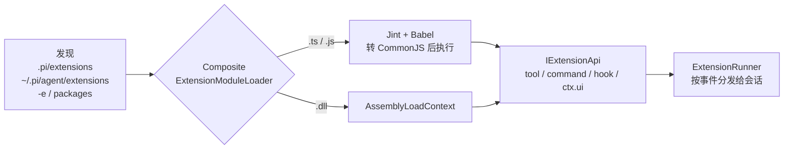

# 上游 pi 插件怎么在 pi.net 里跑

一句话：**上游的 `.ts` / `.js` 扩展原样能跑**——不用改代码，不用先编译成 dll，也不用装 Node。
宿主把 TypeScript 用 Babel（跑在 Jint 上）转成 CommonJS，在同进程里执行。要摸 .NET 库、要强类型、
或者不想每次调用都过一遍 JSON 桥，才写成 `IExtensionEntry` 程序集。

要把这套东西塞进你自己的应用（桌面端 / Web 后端），看 [embedding-plugins.md](embedding-plugins.md)：
SDK 内嵌与 RPC 子进程两种形态、宿主必须实现的 UI 上下文、插件打包与隔离。

## 两条通道

| | 源码插件（上游生态） | 程序集插件（C#） |
|---|---|---|
| 文件 | `.ts` `.tsx` `.js` `.mjs` `.cjs` `.jsx` | `.dll` |
| 入口 | `export default function (pi: ExtensionAPI)` | 唯一一个 public 的 `IExtensionEntry`，`Factory` 等价于 default export |
| 执行 | Jint，一个扩展一个 engine，互不污染 | `AssemblyLoadContext`，可卸载 |
| 依赖 | 自备 `node_modules`，宿主不代跑 npm install | 自己目录优先，契约程序集由宿主提供 |
| 适用 | 直接用上游现成插件 | 要引 .NET 库、要性能、要强类型 |

分派在 `CompositeExtensionModuleLoader`：按扩展名决定走哪个 loader。两者实现同一个
`IExtensionModuleLoader` 接缝，所以同一个目录里 `.ts` 和 `.dll` 能混放。

## 加载链路



`ExtensionLoader` 承担发现与聚合：某个插件加载失败只进 `LoadExtensionsResult.Errors`，不影响其他插件，
启动时作为 diagnostics 打出来——不会因为一个坏插件整个会话起不来。

## 上手三步

下面的 `pi` 指 `dotnet publish src/Pi.Cli -c Release -o ./pi-bin` 出来的可执行文件。

```bash
# 1) 先试一个上游示例，仓库里这份 hello.ts 一行没改
pi -e src/Pi.CodingAgent/Assets/examples/extensions-typescript/hello.ts

# 2) 常驻：项目级跟着仓库走，全局跟着人走
mkdir -p .pi/extensions && cp path/to/plugin.ts .pi/extensions/
#    全局目录：~/.pi/agent/extensions/（Windows 是 %USERPROFILE%\.pi\agent\extensions\）

# 3) 装插件包（扩展 + 技能 + 提示词 + 主题打成一个 npm 包）
pi install npm:@scope/pi-plugin    # 写 ~/.pi/agent/settings.json
pi install ./local-plugin -l       # 写项目 .pi/settings.json（需项目信任）
pi update --extensions             # 按声明重新对齐
```

发现顺序：项目 `.pi/extensions` → 全局 `<agentDir>/extensions` → 显式路径（`-e`、`settings.json`
里的 `packages`）。目录入口先读 `package.json` 的 `pi.extensions`，读不到再按
`index.ts` → `index.js` → `index.dll` 找。同一路径只加载一次。

`-e` 也吃包源：`pi -e npm:@scope/pi-plugin` 只对这一次运行生效，不落设置。`-ne` 关掉全部发现
（显式 `-e` 仍然生效），排查「是不是插件搞的」时先加它。

## 能力边界

| 类别 | 行为 |
|---|---|
| tools / commands / shortcuts / flags / `on()` / `exec` / 发消息 / 会话标题 / 工具开关 | 已桥接 |
| `ctx.ui` 的 notify / select / confirm / input / editor / status / widget | 已桥接 |
| `pi-ai`（`Type`、`StringEnum`、`uuidv7`）、`pi-coding-agent`（`defineTool`、`getAgentDir`、截断助手）、`pi-tui` 组件 | 已桥接 |
| `registerMessageRenderer` / `registerEntryRenderer` / `registerToolRenderer` / `registerMarkdownTransformer` | 降级为警告：插件照常加载，自定义渲染不生效 |
| `registerProvider` / `registerVirtualModel` / `registerMcpServer` / `ctx.ui.custom()` / `process.exit` / `fs.watch` | 直接抛错——静默忽略会让人以为注册成功了 |

还有两条不是「没做完」而是设计如此：插件与宿主同进程、同权限，**插件不是安全边界**，只装信得过的；
`async` 由宿主泵任务和定时器推进，没有常驻事件循环——等 socket、等 worker 的 Promise 不会落地，
会被报成错误而不是挂住。定时器只在处理函数运行期间被泵到，活过这次调用的 `setTimeout` 要等插件
下次被调用才执行；需要跨轮次反应的东西，做成 command / tool / hook。

## 自己写 C# 插件

```csharp
using Pi.CodingAgent.Core.Extensions;

public sealed class HelloExtension : IExtensionEntry
{
    public ExtensionFactory Factory => pi =>
    {
        pi.RegisterCommand("hello", new CommandRegistration
        {
            Description = "打个招呼",
            Handler = (args, ctx) =>
            {
                ctx.Ui.Notify($"Hello, {(args.Length > 0 ? args : "world")}!", "info");
                return Task.CompletedTask;
            },
        });
        return Task.CompletedTask;
    };
}
```

工程文件只有一行是关键：

```xml
<ProjectReference Include="..\..\src\Pi.CodingAgent\Pi.CodingAgent.csproj" Private="false" />
```

`Private="false"` 让 `Pi.CodingAgent.dll` 不跟着插件 dll 进扩展目录——否则同名程序集出现两份，
类型身份对不上，注册的表全是空的。完整可编译的例子见 `samples/Pi.Sample.Extension`。

嵌进自己的 C# 宿主时不用碰装载器：照常 `Sdk.CreateAgentSessionAsync`，扩展目录按 `Cwd` / `AgentDir`
自动发现；要临时指定路径就传 `ResourceLoader` 的 `additionalExtensionPaths`——CLI 的 `-e` 走的就是它。

## 文档归属

- 上游 API 权威：`src/Pi.CodingAgent/Assets/docs/extensions.md`
- 桥接差异清单（这张表的出处）：`src/Pi.CodingAgent/Assets/docs/dotnet-extensions.md`
- 示例：`Assets/examples/extensions-typescript/`（上游原样，可直接加载）、`samples/Pi.Sample.Extension`（C#）
- 包与分发：`Assets/docs/packages.md`

另外 `Assets/examples/plugins/pi-example-plugin` 那种 **Chord facet 插件包**是另一回事：要
`PI_EXPERIMENTAL=1` 起 server/client，走 facet 依赖图，跟扩展生态不是同一套东西。
