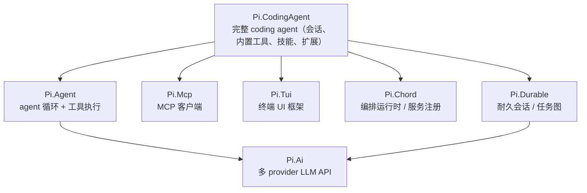

# 包的使用文档

这 13 个 NuGet 包各做一件事，按层组合。本文是索引：先说「你想做的事 → 该装哪个包」，
再给每个包的最小可用示例，最后列出仓库里可直接运行的示例工程。

> 这一套文档讲的是**从 C# 里消费这些包**。如果你只是想用 `pi` 这个 CLI，
> 看随包分发的用户文档：`src/Pi.CodingAgent/Assets/docs/`（`quickstart.md` / `cli.md` /
> `sdk.md` / `mcp.md` / `skills.md` …，上游 TS 版原文，行为与端口一致）。

## 30 秒选型

| 你想做的事 | 装这个 | 看这里 |
|---|---|---|
| 调 LLM 的 API（流式 / 工具调用 / 多 provider） | `Pi.Ai` | [01-pi-ai.md](01-pi-ai.md) |
| 自己写 agent 循环：多轮 + 工具 + 中断 | `Pi.Agent` | [02-pi-agent.md](02-pi-agent.md) |
| 开箱即用的 coding agent（读写文件、跑命令、技能、扩展、会话存档） | `Pi.CodingAgent` | [03-pi-codingagent.md](03-pi-codingagent.md) |
| 连一个 MCP 服务端，列出 / 调用它的工具 | `Pi.Mcp` | [04-pi-mcp.md](04-pi-mcp.md) |
| 终端 UI、RPC、耐久会话、远程执行、遥测、沙箱 JS | 见其它包 | [05-other-packages.md](05-other-packages.md) |

## 分层



越靠上越薄：`Pi.Ai` 只管「把消息发出去、把事件流收回来」；`Pi.Agent` 在上面加状态机和工具
循环；`Pi.CodingAgent` 再把模型目录、凭据、设置、技能、扩展、会话存档、内置工具全部装配好。

## 13 个包

| 包 | 一句话 | 直接依赖 |
|---|---|---|
| `Pi.Telemetry` | 厂商中立的遥测契约（类型化 schema + 参考适配器 + 一致性测试） | — |
| `Pi.Ai` | 统一多 provider LLM API：10 个原生 API 实现、42 个 provider 目录、流式事件、工具调用、思考预算、图像生成、OAuth 登录 | `Pi.Telemetry` |
| `Pi.Agent` | agent 运行时：状态机 + 双队列（steering / follow-up）、agent-loop 主循环、串行 / 并行工具执行 | `Pi.Ai` |
| `Pi.Mcp` | MCP 客户端：JSON-RPC 协议层 + stdio / streamable-http / 内存三种传输 + 完整 OAuth 层 | — |
| `Pi.Tui` | 终端 UI 框架：差量渲染、字素级换行、ANSI/OSC 解析、Kitty 键盘协议、浮层、全屏渲染 | — |
| `Pi.Chord` | 独立的应用编排运行时：服务、复制状态、RPC、facets 依赖图与拓扑激活 | — |
| `Pi.Protocol` | CBOR 线路协议：分帧 / 编解码，与 TS 实现线级兼容 | `Pi.Chord` |
| `Pi.Server` / `Pi.Client` | RPC 服务端 / 客户端：握手、请求分发、取消、推送、Unix domain socket、本地服务发现 | `Pi.Chord` `Pi.Protocol` |
| `Pi.Codemode` | 沙箱 JavaScript 执行，唯一能力是调用注入的工具（默认 Jint VM，可替换引擎） | — |
| `Pi.Durable` | 耐久会话、任务图、恢复；内存 / SQLite / JSONL 三种存储后端 | `Pi.Ai` `Pi.Chord` |
| `Pi.Env` | SSH 远程执行环境：`pi-env` 守护进程客户端及其分帧协议 | `Pi.Chord` `Pi.Durable` |
| `Pi.CodingAgent` | 完整 coding agent：会话运行时、内置工具、技能、主题、RPC 模式、编译成 .NET 的扩展 | 上面十个 |

另有 4 个**可执行**项目不进 NuGet（`IsPackable=false`）：`Pi.Cli`（`pi` 命令）、`Pi.Evals`（评测宿主）、
`Pi.Vacation`（研究/规划宿主）、`Pi.DurableHost`（`pi-durable`）。

## 可运行的示例

`samples/` 下四个控制台工程，全部随解决方案一起编译（CI 也会编译，示例不许烂）：

| 工程 | 演示什么 | 需要密钥 |
|---|---|---|
| [`Pi.Samples.FauxAgent`](../samples/Pi.Samples.FauxAgent) | `Pi.Agent` 完整循环：脚本化模型 + 真执行工具 + 事件流 | 不需要 |
| [`Pi.Samples.RealModel`](../samples/Pi.Samples.RealModel) | `Pi.Ai` 直连真实模型：流式事件、usage、错误处理 | 需要 |
| [`Pi.Samples.CodingSession`](../samples/Pi.Samples.CodingSession) | `Pi.CodingAgent` 的 SDK 工厂：开会话、跑提示词、读统计 | 需要 |
| [`Pi.Samples.McpClient`](../samples/Pi.Samples.McpClient) | `Pi.Mcp` 独立客户端：列工具、调工具、读资源 | 不需要 |

```bash
# 不需要任何凭据，先跑这个确认环境没问题
dotnet run --project samples/Pi.Samples.FauxAgent

# 直连真实模型（ANTHROPIC_API_KEY / OPENAI_API_KEY）
dotnet run --project samples/Pi.Samples.RealModel -- anthropic claude-sonnet-4-5

# 嵌入式 coding agent（需要先登录或配好环境变量）
dotnet run --project samples/Pi.Samples.CodingSession

# MCP 客户端（需要本机有 Node/npx）
dotnet run --project samples/Pi.Samples.McpClient
```

更多细节见 [samples/README.md](../samples/README.md)。

## 专题参考

按端口实际实现写的深度参考（不是上游文档的翻译；每一条都对过源码）：

- **[cli.md](cli.md)** —— `pi` 命令行：子命令、全部选项、端口实际读取的环境变量。
- **[sdk.md](sdk.md)** —— 嵌入 SDK：`CreateAgentSessionOptions` 全字段、`AgentSession` 公开面、不落盘会话。
- **[configuration.md](configuration.md)** —— 全局与项目配置：目录一览、settings.json 字段分组、models.json / mcp.json、信任机制。
- **[sessions.md](sessions.md)** —— 会话存档：文件与目录布局、CLI 入口对照、恢复行为、压缩策略。
- **[codemode.md](codemode.md)** —— codemode：开关与呈现、脚本可用面、`@options`、失败语义、嵌入用法。

## 凭据与配置

三种来源，优先级从高到低：

1. **调用时显式传**：`SimpleStreamOptions.ApiKey`（`Pi.Ai` 层）或 `CreateAgentSessionOptions.Model` +
   环境变量（`Pi.CodingAgent` 层）。
2. **环境变量**：`ANTHROPIC_API_KEY` / `OPENAI_API_KEY` / `DEEPSEEK_API_KEY` / `GEMINI_API_KEY` …
   完整的 provider → 变量名映射在 `Pi.Ai.EnvApiKeys.ProviderEnvMap`，可用 `EnvApiKeys.GetEnvApiKey(provider)` 取值。
3. **凭据文件**：`~/.pi/agent/auth.json`（`pi login` 写入），由 `Pi.CodingAgent` 的模型运行时读取。

`Pi.Agent` 与 `Pi.CodingAgent` 分界很干净：`Pi.Agent` 不认识凭据，它只拿到一个 `StreamFn`
委托；谁去读密钥是 `StreamFn` 自己的事。所以嵌入式场景里你可以把密钥锁在自己的配置系统里，
不用碰 `~/.pi`。

`models.json` 的字段级参考（provider / model / modelOverrides / inputLimits / compat 逐字段的
类型、默认值与说明）见 [models-configuration.md](models-configuration.md)。那一页由
`src/Pi.CodingAgent/Assets/schemas/models.schema.json` 生成，改 schema 后跑
`node scripts/gen-models-configuration.mjs` 重新生成（`--check` 可用于 CI 校验是否过期）。

## 三个常见坑

- **`StreamFn` 是必填的**。`AgentOptions.StreamFn` 没有默认值；不想每次传就调
  `DefaultStreamFn.Set(fn)` 装一个全局默认。忘了会抛
  `No default stream function configured`。
- **模型有两个类型**。`Pi.Ai.Types.Model` 是瘦记录（`Id`/`Name`/`Api`/`Provider`），出现在
  `StreamFn` 边界上；`Pi.Ai.Models.ModelSpec` 是目录里的完整条目（含 `BaseUrl`、`ContextWindow`、
  计价…）。`Pi.CodingAgent` 内部用 `ModelSpec`，往 `Agent` 传时经
  `CompatShims.ToModel()` 转瘦记录。自己写 `StreamFn` 时要知道手里是哪一个。
- **示例要能编译**。`samples/` 里的工程在 `Pi.slnx` 内，改公共 API 时它们会一起报错——这是
  故意的，避免文档里的代码悄悄失效。
